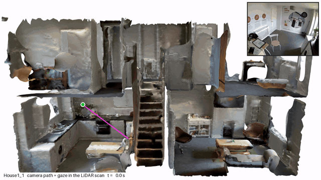
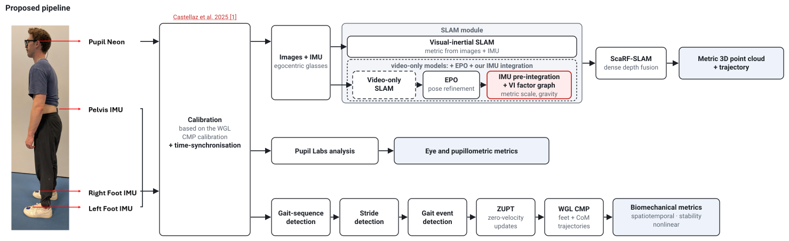

  <h1>Neon-IMU-Pipeline</h1>
  

    Vignesh Radhakrishnan, Mark Hollands 
    School of Sport &amp; Exercise Sciences, Liverpool John Moores University, UK
  

  

  

By leveraging our novel minimal-sensor protocol and processing pipeline, we are able to study the effect of indoor environmental features on gaze and movement, allowing us to identify areas of increased fall risk and sub-optimal movement patterns.

  

The pipeline provides (a) the trajectory of motion in the indoor environment, including a 3D reconstruction map; (b) gait metrics at every step and stride; (c) gaze and pupillometric measures at every step and stride, and over a fixed window period. Example results from a terraced house and a department building are on the [website](https://vigneshrk29.github.io/Neon-IMU-Pipeline/).

## Validation

Each sub-part of the pipeline has been validated using open-source datasets and data collected at the motion capture laboratories at Liverpool John Moores University:

1. [Trajectory validation](https://vigneshrk29.github.io/trajectory-validation/)
2. [Look-ahead distance validation](https://vigneshrk29.github.io/gazeVerification/)
3. [Biomechanical verification](https://vigneshrk29.github.io/Biomechanical-Verification/)
